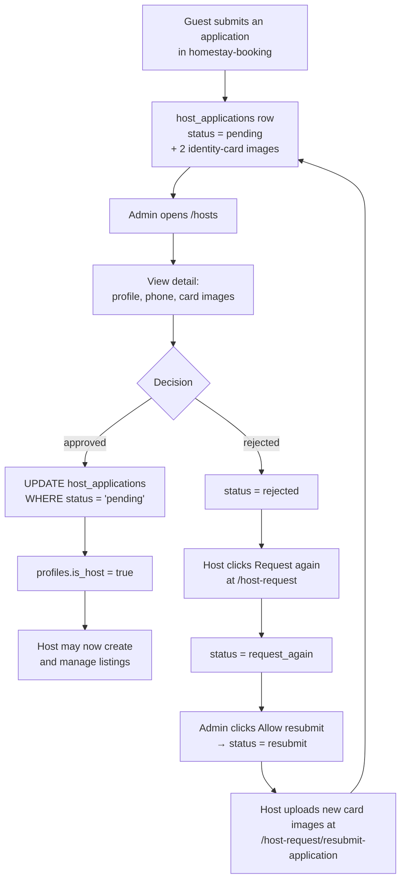
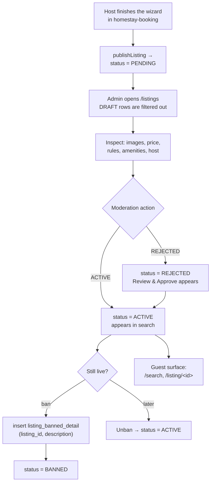
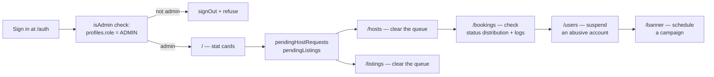

# Homestay Booking Admin — Operations Console

> **The back office for the Homestay Booking marketplace: it decides who may host, which listings go live, who gets suspended, and which promotions appear on the storefront.**

[]()
[]()
[]()
[]()
[]()

---

## At a Glance

|                          |                                                                                                                                                                                       |
| :----------------------- | :------------------------------------------------------------------------------------------------------------------------------------------------------------------------------------ |
| **The problem**          | A marketplace cannot let anyone publish anything. Someone has to verify a host's identity card, read a listing before it goes live, and take a listing down when it breaks the rules. |
| **Who has it**           | The marketplace operator — the team running Homestay Booking, not the guests or the hosts.                                                                                          |
| **How it worked before** | Every approval was a database edit made by hand in the Supabase dashboard, with no record of who approved what or why.                                                               |
| **What this repo does**  | A separate admin console over the same Supabase project: one dashboard, five operational queues, and the state transitions that gate the public marketplace.                        |
| **Measured outcome**     | Four workflows that were free-text database edits — host verification, listing moderation, user suspension, banner management — become screens with a status and an actor.         |
| **Scale**                | ~4,800 lines of TypeScript / TSX · 8 pages · 18 services · 29 commits · 6 contributors                                                                                              |
| **Status**               | Academic course project (FPT University WDP), functional but thin — see [Roadmap](#roadmap)                                                                                          |

> **In one sentence:** it is the second deployable of a two-repo product, and every button in it changes what the guest-facing marketplace shows.

**Companion repo:** the customer and host experience lives in [`homestay-booking`](../homestay-booking/README.md). Both apps point at the **same** Supabase project; this one has no marketplace pages, and that one has no admin pages.

---

## The Problem

Opening a two-sided marketplace to strangers creates four trust problems that the product code cannot solve on its own:

- **Anyone can claim to be a host.** The guest-facing app can collect an identity card, but it must not decide whether that card is real.
- **Anyone can write a listing.** A listing published straight to the storefront is a listing nobody has read — fake addresses, off-platform contact numbers, unreachable prices.
- **Any account can misbehave.** When a guest or host abuses the platform, something has to stop their session from working.
- **The storefront has slots the operator controls.** The hero banner on the landing page is editorial content, not user content — it needs its own manager.

Each of these is a **write** that the ordinary user must not be able to perform. That is exactly the boundary this repo sits on.

---

## The Solution

| Queue       | What the operator does                                                                                    | What changes on the marketplace                       |
| :---------- | :-------------------------------------------------------------------------------------------------------- | :---------------------------------------------------- |
| **Hosts**   | Read an application with both identity-card images, then approve, reject, or allow resubmission          | `profiles.is_host` — the gate for the entire `/hosting/*` console |
| **Listings**| Review a submitted listing in full, then approve, reject, ban with a written reason, or unban | `listings.status` — `ACTIVE` listings are the only ones in search |
| **Users**   | Suspend or reinstate a customer, host, or admin account                                                   | `profiles.status`                                     |
| **Bookings**| Read the platform's booking ledger by status, plus the append-only `booking_logs` trail                   | Read-only — this console observes, it does not intervene |
| **Banner**  | Upload a hero image, set a title, a redirect URL, and an active flag                                       | The landing page carousel                             |

Everything else in the console is a read view of data the other app produced.

---

## Who Uses It

| Role      | How they get in                                                              | What they see                                    |
| :-------- | :--------------------------------------------------------------------------- | :----------------------------------------------- |
| **Admin** | Sign in with an account whose `profiles.role = "ADMIN"`                      | The whole console                                |
| Anyone else | Valid Supabase credentials, but `role ≠ "ADMIN"`                            | The session is destroyed and sign-in is refused  |

There is no self-registration. Admin accounts are created in Supabase and given the role directly.

---

## Core Workflows

### 1. Host application → verified host



The approval writes two rows, and the application update is guarded by `.eq("status", "pending")` — a second click on an already-decided application matches zero rows instead of silently re-approving it. `is_host` is only set on the approve path; rejecting never revokes an existing host.

### 2. Listing moderation → storefront



Every action here is a single `UPDATE listings SET status = …`. Banning additionally records a reason in `listing_banned_detail`, because a ban without a reason cannot be defended to the host who receives it. The guest app reads `BANNED` listings' reasons back through `getListingBannedDetail`.

### 3. The operator's morning



The dashboard counts are what make the console useful at a glance: `pendingHostRequests` and `pendingListings` are the two numbers that should trend to zero.

---

## Key Business Rules

| Rule      | Domain   | What is enforced                                                                                                                                                        |
| :-------- | :------- | :---------------------------------------------------------------------------------------------------------------------------------------------------------------------- |
| **BR-01** | Access   | `signIn` resolves the new session, reads `profiles.role`, and on anything other than `"ADMIN"` calls `signOut()` before returning — a non-admin never holds a usable session |
| **BR-02** | Access   | The dashboard layout redirects to `/auth` whenever there is no session, and renders a spinner until `AuthContext` resolves                                              |
| **BR-03** | Hosts    | An application can only move out of `pending` once: the update is scoped with `.eq("status", "pending")`                                                                 |
| **BR-04** | Hosts    | `profiles.is_host = true` is written only on approval, in the same call that closes the application                                                                     |
| **BR-05** | Hosts    | `allowUserToResubmit` refuses any application not already in `request_again`, and matches on both application id and `user_id`                                          |
| **BR-06** | Listings | `DRAFT` listings are filtered out of the queue entirely — a host's unfinished wizard is never moderated                                                                  |
| **BR-07** | Listings | Banning requires a non-empty reason and inserts a `listing_banned_detail` row carrying it; the page then flips the row to `BANNED` in local state only — `banListing` does not write `listings.status`, so the ban is not persisted (see [Roadmap](#roadmap)) |
| **BR-08** | Listings | The ban button is offered only for `ACTIVE` and `HIDDEN` listings, and only `BANNED` listings can be unbanned back to `ACTIVE`                                        |
| **BR-09** | Users    | Suspension is a `profiles.status` value of `active` or `banned`; the dialog requires confirmation before writing it                                                     |
| **BR-10** | Banners  | Images upload to the `banner` storage bucket under `banners/<timestamp>.<ext>` with `upsert: false`, so a re-upload can never overwrite a live campaign image         |
| **BR-11** | Bookings | This console treats bookings and `booking_logs` as read-only. Status transitions belong to the host, in the other app                                                    |

---

## Architecture & Tech Stack

**Stack:** Next.js 16.1 (App Router) · React 19.2 · TypeScript 5 · Tailwind CSS 4 · Supabase (PostgreSQL + Auth + Storage) · Radix UI · lucide-react · react-hot-toast

### Shape

```
app/auth/page.tsx            Public sign-in, the only unauthenticated route
      │
      ▼
app/(dashboard)/layout.tsx   Client shell: session guard + sidebar
      │
      ▼
app/(dashboard)/*/page.tsx   One page per queue, all "use client"
      │  imports
      ▼
src/services/<domain>/*.ts   18 modules, one verb each
      │  supabase-js
      ▼
Supabase                     shared project with homestay-booking
```

Two things distinguish this app from its companion:

- **There is no API layer at all.** Zero route handlers. Every read and write is a browser-side query against the shared database. The email-sending endpoints live in `homestay-booking`, not here.
- **There is no server-side authorization.** The `isAdmin` check runs in the browser, before the session is handed back to the UI. Row Level Security on the Supabase project is what actually protects the data — see [Roadmap](#roadmap).

### Routes

| Path        | File                                  | Purpose                                                        |
| :---------- | :------------------------------------ | :------------------------------------------------------------- |
| `/auth`     | `app/auth/page.tsx`                   | Email + password sign-in with the admin gate                   |
| `/`         | `app/(dashboard)/page.tsx`            | Four stat cards, two action-needed panels, recent bookings and listings |
| `/users`    | `app/(dashboard)/users/page.tsx`      | Three tabs: customers, hosts, admins; search and suspend       |
| `/listings` | `app/(dashboard)/listings/page.tsx`   | Status tabs and a detail drawer with moderation actions        |
| `/hosts`    | `app/(dashboard)/hosts/page.tsx`      | Application queue with identity-card preview                   |
| `/bookings` | `app/(dashboard)/bookings/page.tsx`   | Status tabs plus a `booking_logs` tab                          |
| `/banner`   | `app/(dashboard)/banner/page.tsx`     | CRUD over hero banners with image upload                       |
| `/test`     | `app/(dashboard)/test/page.tsx`       | A `toast.success("hello world")` button — dev scaffolding      |

### Tables read or written

`profiles` · `listings` · `listing_banned_detail` · `bookings` · `booking_logs` · `host_applications` · `banners` · `experiences`

Eight tables out of the 33 the companion app uses. Everything else is invisible here by design.

### Session model

`src/contexts/AuthContext.tsx` subscribes to `supabase.auth.onAuthStateChange` and pushes the session into React state; both the root layout and the dashboard layout consume it. `getSession()` on mount handles the refresh case. Nothing is cached in cookies or validated on a server — the session lives in the browser exactly as Supabase-js stores it.

---

## Project Scale

| Metric                          | Value                                                     |
| :------------------------------ | :-------------------------------------------------------- |
| Source lines (TypeScript / TSX) | 4,831                                                     |
| App Router pages                | 8                                                         |
| API route handlers              | 0                                                         |
| Service modules                 | 18                                                        |
| Components                      | 18 total — 10 feature components, 8 UI primitives          |
| Domain type files               | 29 (copied from the companion app)                        |
| Database tables accessed        | 8                                                         |
| Commits                         | 29 across 11 branches                                     |
| Contributors                    | 6 people, 7 git identities                                |
| Tracked files                   | 93                                                        |
| History                         | 2026-02-05 → 2026-03-27                                   |
| Largest file                    | `app/(dashboard)/listings/page.tsx` — 748 lines           |

---

## Getting Started

### Prerequisites

- Node.js 20+
- Access to the **same** Supabase project as `homestay-booking` — this app is useless against a fresh, empty one
- At least one `profiles` row with `role = "ADMIN"`, created directly in Supabase
- The `banner` storage bucket, if you want the banner page to work

### Install and run

```bash
git clone <homestay-booking-admin-repo>
cd homestay-booking-admin
npm install
```

Create `.env.local`:

| Variable                        | Required | Purpose                                            |
| :------------------------------ | :------: | :------------------------------------------------- |
| `NEXT_PUBLIC_SUPABASE_URL`      |    ✅    | Must match the marketplace project                 |
| `NEXT_PUBLIC_SUPABASE_ANON_KEY` |    ✅    | Anon key — the only credential this app ever uses  |

```bash
npm run dev      # http://localhost:3000
npm run build    # production build
npm run lint     # ESLint 9
```

> Run the companion app on a different port (`npm run dev -- -p 3001`) if you are testing both locally. They are separate deployments that happen to share a database.

> **No seed data and no `.env.example`.** The table above is reconstructed from the `process.env.*` references in `src/lib/supabase.ts`.

> **Breaking import — read this before building.** `src/types/listing-response.ts` starts with `import { Listing } from "../../../../homestay-booking/src/types/listing";` — a path that escapes this repository and only resolves if the sibling checkout sits at exactly that relative location. The file is not imported anywhere, so the build does not currently fail; if you add a type import from it, delete the line first.

---

## Project Structure

```
homestay-booking-admin/
├── app/
│   ├── layout.tsx                   Root shell: AuthProvider + Toaster
│   ├── auth/page.tsx                Sign-in
│   └── (dashboard)/
│       ├── layout.tsx               Session guard + sidebar
│       ├── page.tsx                 Dashboard
│       ├── users/ listings/ hosts/
│       ├── bookings/ banner/ test/
├── components/ui/                   8 shadcn primitives
├── lib/
│   ├── supabase.ts                  The shared anon-key client
│   └── utils.ts                     cn()
└── src/
    ├── components/
    │   ├── dashboard/               StatCard + the two recent-activity tables
    │   ├── layout/                  SidebarItem
    │   ├── user/                    One table per role tab
    │   └── common/                  Avatar, StatCard
    ├── contexts/AuthContext.tsx     Session state
    ├── services/                    18 modules, by domain
    │   ├── auth.ts                  signIn + the isAdmin gate
    │   ├── dashboard/               getDashboardStats, recents
    │   ├── host/                    Applications: list, detail, decide, resubmit
    │   ├── listing/                 List, update status, ban
    │   ├── user/                    Customers, hosts, admins, suspend
    │   ├── booking/                 Bookings + logs
    │   ├── banner/                  CRUD + upload
    │   └── experience/
    ├── types/                       29 files copied from the companion app
    └── utils/                       Date formatting
```

---

## Development Conventions

Same rules as the companion repo, because the same team maintains both:

- **Never push to `main` or `dev`.** Branch as `feature/…`, PR back into `dev`.
- **Conventional Commits** — `feat`, `fix`, `refactor`, `docs`, `chore`.
- **A query belongs in `src/services/`**, one verb per file. Pages call services; they do not call `supabase.from()` directly except in the two places that already do.
- **Types are copied, not shared.** When a table changes in the marketplace repo, the matching file in `src/types/` must be updated by hand here.

---

## Testing & Quality

**Automated tests: none.** No runner, no test files, no CI workflow.

What does exist:

- **Linting** — ESLint 9 with `eslint-config-next`.
- **Initialization guards** — `signIn` cannot return success without an `ADMIN` role, and the dashboard layout refuses to render without a session. These two checks are the whole access model, and they are deliberately written as early returns so a failed read cannot fall through to a rendered page.
- **Guarded writes** — the host-application update carries `.eq("status", "pending")`, and `allowUserToResubmit` verifies the current status before writing. Both are the kind of rule that would otherwise need a test to protect.
- **A dev route left in** — `/test` renders a single toast button. It is harmless and it is also clearly not part of the product.

---

## Roadmap

Shipped:

- [x] Admin-only sign-in with forced sign-out for non-admin credentials
- [x] Dashboard with 11 counts behind four stat cards and two "action needed" panels
- [x] Host application queue with identity-card image preview
- [x] Approve / reject that closes the application and flips `is_host`
- [x] "Allow resubmit" path with a status guard
- [x] Listing moderation: approve, reject, unban, and a ban flow that records a reason
- [x] User directories by role, with search and suspension
- [x] Booking ledger with status tabs and a `booking_logs` view
- [x] Banner CRUD with storage upload

Not yet built:

- [ ] **Server-side authorization.** The `ADMIN` check runs in the browser. Anyone holding a valid anon key can query the same tables through the Supabase REST API directly; today the only real barrier is Row Level Security. A Next.js middleware or a set of server actions should re-check the role before any write
- [ ] **Ban is not persisted.** `banListing` only inserts into `listing_banned_detail`; it never updates `listings.status`. The page shows the row as `BANNED` in local state, so the ban looks applied until the list is reloaded. Either write both in the service, or make the follow-up `updateListingStatus(id, "BANNED")` call explicit
- [ ] **`HIDDEN` is unreachable.** The status tab and the `ACTIVE | HIDDEN` ban branch both exist, but no button in the console moves a listing to `HIDDEN`. It can only arrive there from another client
- [ ] **Suspension is only partly wired.** `profiles.status = "banned"` is written here, and `ProfileStatusProvider` in the guest app reads it — but only to block `/hosting/*` and `/book/*` routes; the account can still browse and stay signed in
- [ ] **Audit trail on admin actions.** `booking_logs` records booking changes, but nothing records which admin approved a host or banned a listing
- [ ] **Pagination.** Every queue loads its full table and filters in the browser — fine at course-project scale, not at real scale
- [ ] **Fix the cross-repository import** in `src/types/listing-response.ts`, or delete the file
- [ ] **Remove the `/test` route** before any deployment
- [ ] **Automated tests and CI** — at minimum, a unit test per guarded status transition
- [ ] **Metadata.** `app/layout.tsx` still carries the create-next-app title and description

---

## Team

| Contributor           | Commits |
| :-------------------- | ------: |
| `hoang240`            |      10 |
| Hau Nguyen (`hau0909`) |      12 |
| `jooyoung`             |       3 |
| `jooyoung_coding`      |       2 |
| `ChauTriet`            |       1 |
| `TrietCMCE180982`      |       1 |

Counts are from `git shortlog -sn --all`. `Hau Nguyen` and `hau0909` are one person committing under two git identities. Contributions are concentrated on `feat/admin-management` and its fix branches, which is why a small repo still shows 11 branches.

---

## License

Academic course project, FPT University. Not licensed for commercial use.
